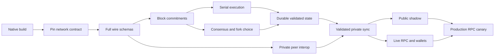

# Native network readiness

The Rust-only build boundary has passed. The early private native profile now synchronizes and selects competing branches across independent Rust OS processes, with persistent peer identities, receiver/source restart, SIGKILL recovery, cancellation and bounded controls. A known local head requires no connection. Full global consensus, production storage, automatic public head following and live validated RPC remain unqualified. See [process results](NATIVE_PROCESS_RESULTS.md). No public peer or wallet operation occurred.

The first proposed product is a non-mining validating node that can serve RPC.
It still must validate imported PoW, rewards and the prime/region/zone protocol.
Mining work generation/Stratum and replacement Go SDK libraries can follow.
This is functional wire/consensus/API compatibility, not a literal translation
of every Go helper or its database layout.

## Choose the protocol contract first

The offline reference is official upstream source
`33db82f2891b267ba898ca38bd2dd8bf75cbb072`, VERSION v0.57.0, including
Polaris activation at Prime terminus block 2,444,574. The last published release
observed during this update was v0.56.1; source VERSION and published artifacts
are tracked separately. The five prior local fee-feature commits are preserved
on `backup/pre-polaris-fees-20261110` and are inactive in the new baseline.
[The migration report](NATIVE_UPSTREAM_RESULTS.md) records native updates and
unimplemented economic/network changes. A source pin alone does not establish
the network/genesis/fork configuration or complete consensus compatibility.

Before runtime implementation, pin the exact release/source, chain ID,
genesis for each required context, location, active hierarchy, engine and fork
schedule, protocol limits, checkpoint and dependency versions. Colosseum
mainnet chain 9 / zone [0,0] is a proposed eventual target, not a confirmed or
qualified configuration. [The planning template](compatibility/network-target.template.json)
intentionally has unresolved mandatory fields and must never be loaded as a
node configuration. [The frozen private development contract](configs/private-native-v1.json)
now declares chain 1337, its hierarchy/genesis/fork/source hashes, empty
allocations and loopback transport. It does not qualify complete historical
economic state or full consensus.

Activated mixed execution also composes with native zone/region/prime preparation on two supplied-checkpoint branches. [Coincident replay results](NATIVE_COINCIDENT_RESULTS.md) track 24 distinct conditional blocks, 246 valid-work rejections and lazy branch recovery separately from the early genesis-linked canonical corpus. This does not widen private node admission or authenticate the checkpoint.

The experimental `private-execution-v2` profile starts from the declared empty genesis and now qualifies an 8192-block pre-transaction prefix plus independent-process acquisition in 64 bounded windows. Its separate fingerprint does not upgrade the existing v1 contract. [Genesis/sync results](NATIVE_GENESIS_SYNC_RESULTS.md) distinguish this native prefix from the ongoing genesis-to-activation run and from full public consensus.

## Promotion gates

| Gate | Deliverable and acceptance boundary | Dependencies | Status |
| --- | --- | --- | --- |
| B0 | Native build/distribution/runtime with Go denied; frozen reads still explicitly unverified | — | Passed for current artifact |
| G0 | Immutable network/genesis/fork/engine/fee/limit contract | B0 | Partial: private contract frozen; full target qualification open |
| G1 | Full schemas and bounded work-object, body, auxiliary and peer envelope decoding | G0 | Partial: all raw declarations; bounded canonical views; auxiliary semantics/limits open |
| G2 | Full block/header/body/transaction/receipt/ETX commitment verification | G1 | Partial: bounded body/header/list/receipt commitments |
| G3 | Serial Quai EVM + Qi/ETX state/economic replay with exact roots, gas, fees and receipts | G2 | Partial: signed Quai/Qi, ETX/economic components, early canonical replay and checkpoint-based activated local/coincident replay; full fork/economic history open |
| G4 | PoW/AuxPoW/workshares, hierarchy/PoEM/expansion and fork choice | G2 | Partial: native proofs, bounded headers and candidate append components; full branch/economic validation open |
| G5 | Durable canonical account/UTXO/ETX state and indexes; atomic commit, reorg and crash recovery | G3, G4 | Partial: early private native canonical generations, reorg/crash recovery; production/global state open |
| G6 | Controlled Rust-Go libp2p streams, discovery, gossip and hostile-peer interoperability | G1 | Partial: actual private Go/Rust Noise/Yamux streams, framing/enrollment and gossip validation tests |
| G7 | Independent private-network sync with native validation and fork choice | G2–G6 | Partial: existing 24-block early fork corpus plus a separate 8192-block experimental genesis prefix across independent Rust processes; bounded forward windows, restarts, SIGKILL and cancel/resume; activation/general/public sync open |
| G8 | Public shadow sync and archived fork-boundary replay through declared height/hash | G7 | Open |
| G9 | Live RPC, filters/WS, pool/submission and Quais.js/Pelagus compatibility | G3, G5, G7 | Frozen subset only |
| G10 | Sustained Linux correctness/resource/latency qualification and limited RPC canary | G8, G9 | Open |
| G11 | Optional mining/Stratum and remaining client/admin/debug surfaces | G10 | Deferred for first product |

[Machine-readable gates](compatibility/network-gates.json) hold exact acceptance
criteria and proof links. A status cannot pass without immutable evidence and
passed dependencies. Run `python3 scripts/check_network_plan.py` to check the
DAG, recorded proof results and consistency of the active scope. That is a
structural check, not a network test. There are no dates or whole-node
throughput promises yet.

A lab peer prototype may exchange **unverified** messages before execution is
complete. That closes only controlled interoperability cases. Independent sync
requires native validation, state and fork choice. No Go process may decide the
canonical state for the shipping client.

## P2P implementation contract

The pinned code uses libp2p: persistent identity, transports/Noise/multiplexing,
identify, connection/resource management, discovery and gossip. A
[Rust libp2p implementation](https://github.com/libp2p/rust-libp2p) is a candidate
building block; interoperability with Quai still requires explicit tests.
Do not build an Ethereum devp2p/RLPx client and assume it speaks Quai.

Source anchors to preserve in controlled interoperability:

- `p2p/protocol/constants.go`: application stream protocol `/quai/1.0.0`.
- `p2p/node/node.go`: DHT prefix `/quai`, transport/security configuration,
  persistent peer identity, gating and resource controls.
- `common/stream_services.go`: four-byte big-endian message length and a
  3 MiB incoming stream cap. Test truncated/oversized frames before allocation.
- `p2p/pb/quai_messages.proto`: request ID, location and typed requests/responses;
  gossip envelopes carry Protobuf work objects, transactions and auxiliary templates.
- `p2p/node/pubsubManager/` and `params/protocol_params.go`: 3 MiB gossip cap;
  topic names derive from genesis, comma-separated location and message type.
  Match validation, mesh/scoring, subscription and duplicate policies as well.

The current one-MiB transaction-decoder limit and 4,096-item bounds are prototype
constraints, not qualified consensus limits. Audit actual field/list maxima and
per-message/per-peer budgets so the client neither rejects valid network blocks
nor admits unbounded work. Typed-RLP decoding remains necessary for raw signed
transaction RPC; it is not the full-work-object P2P codec.

## Execution and state contract

Start with serial block replay. A generic EVM library needs Quai opcode,
address/ledger, access-list, gas, fee, rent, precompile and ETX adaptations.
Qi signature mathematics alone does not establish ownership, nonexistence of
double spends, balances, locks, fees or valid UTXO commitments. Full replay must
compare acceptance/rejection, all account/UTXO/ETX roots, ordered receipts/logs,
gas/fees/rewards and emitted ETXs from identical pre-state. Include rejected
blocks, branch competition and every relevant fork boundary.

Use one Rust-owned canonical generation for state, chain metadata and RPC
indexes. Keep availability explicit. Crash/reorg testing is part of correctness,
not just an operational benchmark. A native database schema is acceptable;
Go-file-format migration is a separate compatibility decision.

Only after serial equivalence should we add parallel execution: isolate state,
validate conflicts and deterministically merge account, UTXO and ETX changes.
Mandatory access lists do not by themselves describe every dependency.

## Work packages and next implementation batch

Proposed crate boundaries: `quai-chain-spec`, `quai-consensus`, `quai-state`,
`quai-execution`, `quai-db`, `quai-network`, `quai-sync`, `quai-txpool` and a
`quai-node` orchestrator, reusing existing primitives/store/RPC where appropriate.
The execution, network and consensus crates now exist as bounded component
libraries. Other listed boundaries are planned and carry no coverage credit.
The source ledger also pins `go.mod`/`go.sum`; imported library implementations
are outside the 506-file Go source count. Audit dependency behavior, licenses and Rust
replacement choices explicitly for transport, storage, proof engines and VM
precompiles. Reusing a Rust library still needs protocol compatibility evidence.

1. Close G0 and create whole work-object/body/receipt/auxiliary and peer-envelope
   vectors; finish canonical schemas/commitments for G1/G2. Develop typed-RLP
   ingress separately for G9.
2. Define pre-state/block/result interfaces and build serial execution and
   consensus differentials. Cover custom EVM, Qi/ETX/economics and all selected
   proof/hierarchy rules. In parallel, develop controlled G6 peer transcripts
   with unverified status until validation exists.
3. Add durable canonical state, reorg/crash tests and independent private sync.
4. Run public shadow validation; expand native RPC/pool/wallet behavior against
   the validated state, then qualify a limited production canary.

The [source map](PORTING_MAP.md) assigns every tracked Go file and all declared
Protobuf messages to a work package. The [allocation plan](docs/ALLOCATION_PLAN.md)
contains measured component opportunities; it cannot substitute for these gates.

## Implemented foundation and remaining limits

[The current increment](NATIVE_FOUNDATION_RESULTS.md) adds checked-in raw
bindings for all five schemas, bounded complete-work-object/body/receipt
commitments, raw/secure trie snapshot roots, intrinsic gas, Qi input prechecks
and live StateDB ETX queue/index/root equivalence. ETX roots preserve auxiliary
metadata opaquely; economic calculations and eligibility are still absent.

The application codec/request book/topic helpers are implemented. The raw
loopback test uses the Go stream helpers over TCP without a libp2p handshake.
It cannot pass the full G6 gate. Prototype limits still need qualification:
3 MiB frames/messages, 65,536 fields, 16,384 nested messages, depth 32,
4,096 work-object transaction/hash/uncle items, 256-bit magnitudes,
64 MiB commitment values and a 32 MiB/16,384-entry in-memory ETX payload domain.
ETX queue indices are bounded to u64. Protobuf groups and active auxiliary
semantic forms remain unsupported. These are implementation scope limits,
not newly invented network consensus rules.

The [serial VM increment](NATIVE_EVM_RESULTS.md) now adds bounded isolated
frames and account/storage roots. Gas/refund/logs, access-list checks, fork
gates and instruction traces match the declared corpus. G3 remains partial:
calls/creation/precompiles, complete transaction/Qi/ETX economics, consensus
and full-block replay are still open. This library is not connected to RPC
simulation or canonical chain authority.

The [consensus increment](NATIVE_CONSENSUS_RESULTS.md) supplies native proof
kernels, ordinary difficulty/PoEM projections and supported header/body proof
binding. G4 is partial. Raw donor hashing is not proof of a valid merged-mined
Quai block: auxiliary templates, signatures, coinbase/Merkle commitments and
full hierarchy/fork-choice policy still require implementation and replay.
The full block-admission API returns unsupported, so these helpers cannot
promote an imported block or establish canonical chain authority.

The [signed auxiliary increment](NATIVE_AUXILIARY_RESULTS.md) implements the
bounded native quorum/template/coinbase/Merkle/Quai binding stage and integrates
valid supported KAWPOW block proofs. G4 remains partial: role classification
and signed binding do not establish workshare difficulty/history/count policy,
full header/uncle validity, hierarchy fork choice or economic state replay.
The runtime's quorum is a trusted chain-spec input, never proof-provided keys.

Bounded zone ancestry and share-inclusion components now have separate history evidence (`NATIVE_HISTORY_RESULTS.md`). Candidate snapshots are unverified; their checks do not close G4 or authorize canonical publication. Full-header policy, reward accounting, hierarchy/fork choice and multi-block state replay remain required.

Bounded zone header policy, entropy/expansion/prime/controller bindings and conversion-derived base fees have separate evidence in `NATIVE_HEADER_RESULTS.md`. Parent policy and candidate proof stages remain distinct. Economic settlement, complete hierarchy/genesis policy, canonical history and native sync remain required.

Bounded prime/region header policy now has separate evidence (`NATIVE_HIERARCHY_RESULTS.md`). Native component reports expose whether parent work was checked and keep canonical authority false. Hierarchy placement, expansion/genesis qualification, economic replay and fork choice remain required.

Bounded candidate append preparation now has isolated-policy and actual native
proof/header/body evidence (`NATIVE_PLACEMENT_RESULTS.md`). It computes
order/rank/routing, local parent commitments and PCRC transitions without
mutating supplied candidate history/indexes. G4 remains partial: expansion/genesis
initialization, full cross-context branch eligibility, reward/state replay,
fork choice and durable canonical publication are still required.

Genesis/candidate-branch increment (2026-11-10): bounded canonical genesis
construction, expansion geometry, explicit default-genesis difficulty and
atomic candidate storage now have source and native multi-block evidence in
[NATIVE_GENESIS_RESULTS.md](NATIVE_GENESIS_RESULTS.md). Two sibling branches
advance without canonical selection. Next: qualify expansion allocation/state
initialization and cross-context branch scoring/eligibility, then economic replay,
fork choice and durable reorg/crash recovery. Full block admission and sync
remain unavailable.

PoEM/frontier increment (2026-11-10): native local candidate scoring, constructed
expanded-genesis zone startup, coordinator NodeSet projections and entropy-keyed
pending views are tracked in [frontier results](NATIVE_FRONTIER_RESULTS.md).
Go's legacy location names alias regions >=3; default views reject ambiguous
layouts and an explicit consistent legacy view reproduces that source behavior.
Runtime coordinator/generation integration, allocations and economic replay,
canonical fork choice, durable state/reorg recovery and native sync remain open.

Global-eligibility increment (2026-11-10): bounded imported multi-context ancestry,
constraint tracing and cross-context PCRC frontier gates now compose with native
candidate scoring. [Eligibility results](NATIVE_ELIGIBILITY_RESULTS.md) record
14,328 comparisons, including six native coincident blocks checked in all three
contexts. Consistency checks preserve unverified-history status. Next: runtime coordinator/generation integration and candidate retention, followed
by allocation/economic replay and durable canonical state before network sync.

Coordinator selection/reapplication increment (2026-11-10): recent admission,
exact pinned-Go tie ordering, bounded global leader search/retries and native
score-bound pending-frontier reapplication are tracked in
[coordinator results](NATIVE_COORDINATOR_RESULTS.md). The new corpus has 42,731
comparisons; all outputs retain unverified-history status. Generation workers,
pending-header body assembly and runtime event integration remain open. Next:
define block pre-state/results, complete nested-call and transaction/Qi/ETX
economic replay, and add durable canonical commits/reorg recovery before sync.

Official upstream update (2026-11-10): the active source baseline is **v0.57.0**
`33db82f2891b267ba898ca38bd2dd8bf75cbb072`, including the merged Polaris changes.
Local fee-feature commits are preserved separately on
`backup/pre-polaris-fees-20261110`. [Migration results](NATIVE_UPSTREAM_RESULTS.md)
record binding/identity/Qi-input changes, fresh corpora and the economic/network
work that remains open. Polaris activates at Prime terminus block 2,444,574.
The current runtime remains a frozen unverified RPC view with native libraries;
full transaction replay, canonical state and native sync remain unavailable.
